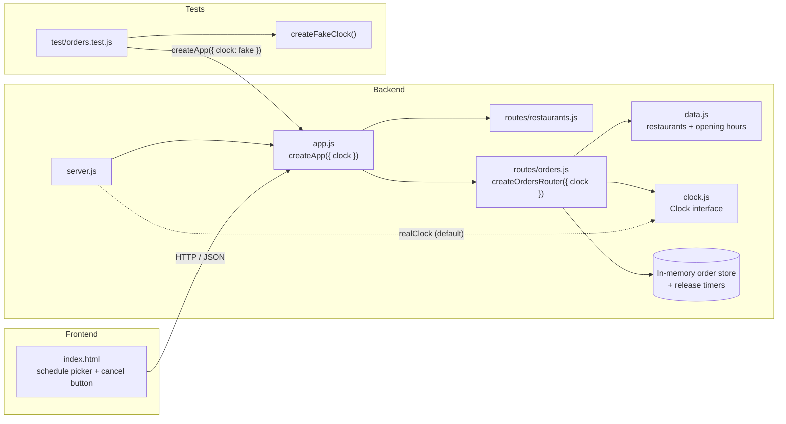
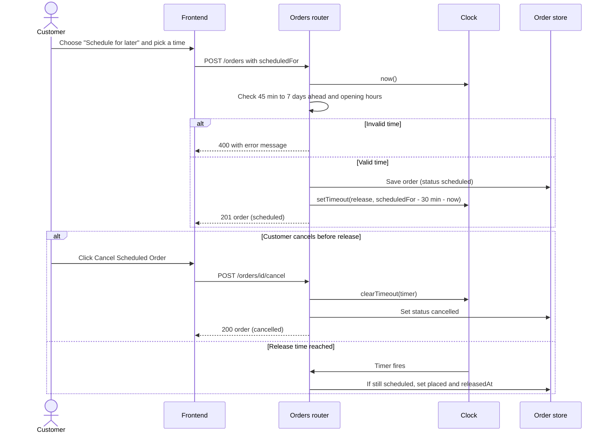

# MiniDash - Scheduled Orders: Design

## 1. Summary

Customers can attach an optional delivery time (scheduledFor) to an order. The orders router validates it, stores the order as scheduled, and starts a per-order release timer through an injected clock. When the timer fires 30 minutes before delivery, the order moves to placed exactly once. A new cancel endpoint lets the customer cancel while the order is still scheduled. All time-dependent code reads time and starts timers only through the clock, so tests can swap in a fake clock and control time.

See requirements.md for the acceptance criteria this design satisfies.

## 2. Components Touched

- Backend/src/clock.js (new): realClock for system time and createFakeClock() for tests.
- Backend/src/app.js (new): createApp({ clock }) builds the Express app so tests can inject a clock.
- Backend/src/server.js (changed): now only starts the app created by createApp().
- Backend/src/routes/orders.js (changed): scheduling validation, release timer, cancel endpoint and the scheduled status. Exported as createOrdersRouter({ clock }).
- Backend/src/data.js (changed): order store removed. It now lives inside each router instance.
- Backend/src/routes/restaurants.js (unchanged): opening hours are read from the existing restaurant data.
- Frontend/public/index.html (changed): Deliver ASAP / Schedule for later picker, scheduled time display and cancel button.
- Backend/test/orders.test.js (new): tests driven by the fake clock.
- Backend/package.json (changed): npm test script.

Component diagram:

## 3. Interfaces

### 3.1 Clock interface (internal)

Every clock passed to createApp provides:
- now(): returns the current time in milliseconds
- setTimeout(fn, ms): runs fn after ms milliseconds and returns a timer id
- clearTimeout(id): cancels a pending timer

The fake clock also provides:
- advance(ms): moves time forward and runs any timers that come due, in order

realClock wraps Date.now, setTimeout and clearTimeout. createApp({ clock }) uses realClock by default and passes the clock to createOrdersRouter({ clock }).

### 3.2 HTTP API changes

POST /orders accepts a new optional field, scheduledFor, as an ISO date and time. Example body:

    {
      "restaurantId": 1,
      "deliveryAddress": "123 Main St",
      "items": [{ "menuItemId": 101, "quantity": 2 }],
      "scheduledFor": "2026-10-31T17:00:00.000Z"
    }

Responses:
- scheduledFor omitted: 201, status placed (unchanged behaviour)
- valid scheduledFor: 201, status scheduled
- not a valid date: 400 "scheduledFor must be a valid date/time"
- less than 45 minutes ahead: 400 "Scheduled orders must be at least 45 minutes from now"
- more than 7 days ahead: 400 "Orders can only be scheduled up to 7 days ahead"
- outside opening hours: 400 "<Restaurant> is only open HH:MM-HH:MM"

GET /orders/{id} returns two new fields:
- scheduledFor: the requested delivery time, or null for immediate orders
- releasedAt: when the order was released to the restaurant, or null until then

POST /orders/{id}/cancel is a new endpoint:
- order is scheduled: 200, order becomes cancelled and its release timer is stopped
- order already released: 409 "This order has already been released to the restaurant and can no longer be cancelled"
- order already cancelled: 409 "This order is already cancelled"
- unknown id: 404 "Order not found"

PATCH /orders/{id}/status: a scheduled order can only move to cancelled. A manual move to placed returns 409, because only the release timer can release an order.

### 3.3 Status lifecycle

- scheduled -> placed (automatically, 30 minutes before delivery)
- scheduled -> cancelled (customer cancels before release)
- placed -> accepted -> preparing -> ready_for_pickup -> picked_up -> delivered
- placed, accepted or preparing -> cancelled (restaurant or driver tools)

## 4. Data Changes

### 4.1 Order record

- status (changed): new value scheduled.
- scheduledFor (new): requested delivery time as an ISO string, or null.
- releasedAt (new): set once when the order moves from scheduled to placed, otherwise null.
- statusHistory (unchanged): for scheduled orders it gains a scheduled entry and exactly one placed entry.

### 4.2 Server-side state

- The order store (a Map of order id to order) moved from data.js into each createOrdersRouter() call, so every app instance and every test starts empty.
- Release timers (a Map of order id to timer id) are new. They are used to stop a pending release when an order is cancelled.
- There is no database. All state is in memory.

### 4.3 Constants in orders.js

- MIN_LEAD_MINUTES = 45
- MAX_DAYS_AHEAD = 7
- RELEASE_LEAD_MINUTES = 30

## 5. Key Flow

## 6. Testing Approach

- Tests create the app with createApp({ clock: createFakeClock(start) }) and listen on a random port.
- The start time is fixed at noon local time, so opening-hours checks do not depend on the time zone.
- clock.advance(ms) simulates time passing. For example, one test checks that an order is still scheduled 31 minutes before delivery, is placed at 30 minutes before, and still has only one placed entry two hours later.
- Edge cases covered: exactly 45 minutes and exactly 7 days (accepted), 44 minutes and 7 days plus 1 minute (rejected), cancel before release, cancel after release, and blocked manual early release.

## 7. Architecture Decision Record

### ADR-001: How scheduled orders are released

Status: Accepted

Context:
A scheduled order must move from scheduled to placed 30 minutes before its delivery time, exactly once, and never if the customer cancelled it. The mechanism must also be testable without waiting in real time.

Options considered:

1. Polling loop. A setInterval checks all orders every 30 seconds and releases any that are due.
   - Pros: simple, and one loop handles every order.
   - Cons: releases can be up to 30 seconds late. It does work even when nothing is due. It is hard to control in tests unless the interval is also injected. This was our first draft.

2. Per-order timer through an injected clock. When a scheduled order is created, one timer is set for scheduledFor minus 30 minutes. Cancelling clears it.
   - Pros: releases on time, does no work while idle, and cancelling is explicit. With a fake clock, tests trigger the release instantly.
   - Cons: timers live in memory and are lost on restart. There is one timer per pending order.

3. Lazy release on read. No timer. The status is worked out when an order is fetched: if it is past release time, it is treated as placed.
   - Pros: no background work and nothing lost on restart.
   - Cons: the restaurant never receives the order unless something reads it. releasedAt would be recorded at read time instead of release time. Every read path must remember to apply the rule.

Decision:
Option 2, a per-order timer created through the injected clock.

Consequences:
- Releases happen at exactly 30 minutes before delivery. The release function only acts while the order is still scheduled, so it runs exactly once and is skipped for cancelled orders even if a timer fires.
- Pending releases are lost if the server restarts. This is accepted because orders are also stored in memory and are lost on restart (listed as out of scope).

## 8. Risks and Limitations

- Restarts: scheduled orders and timers are lost when the server restarts.
- No authentication: anyone with an order id can cancel a scheduled order.